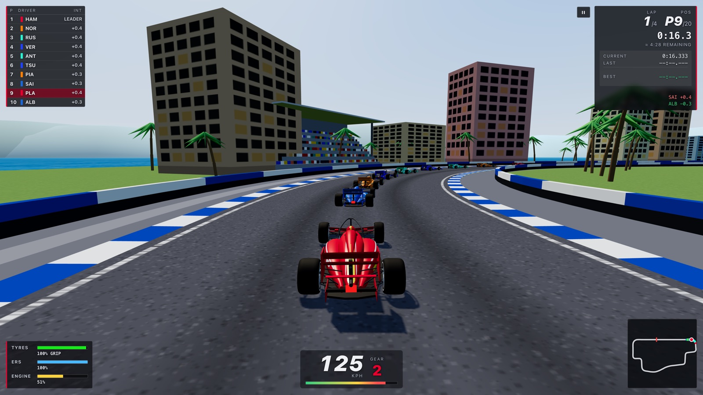
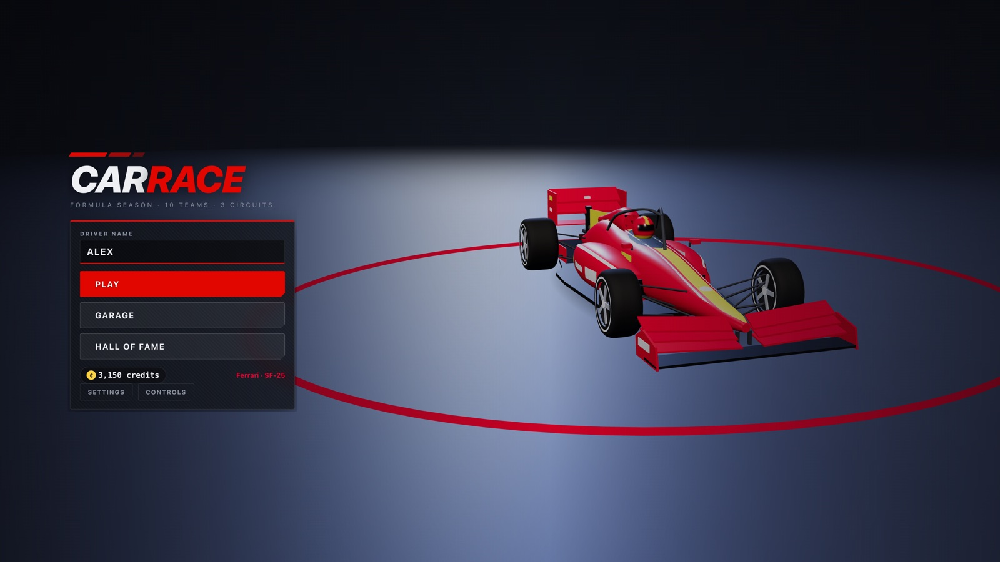
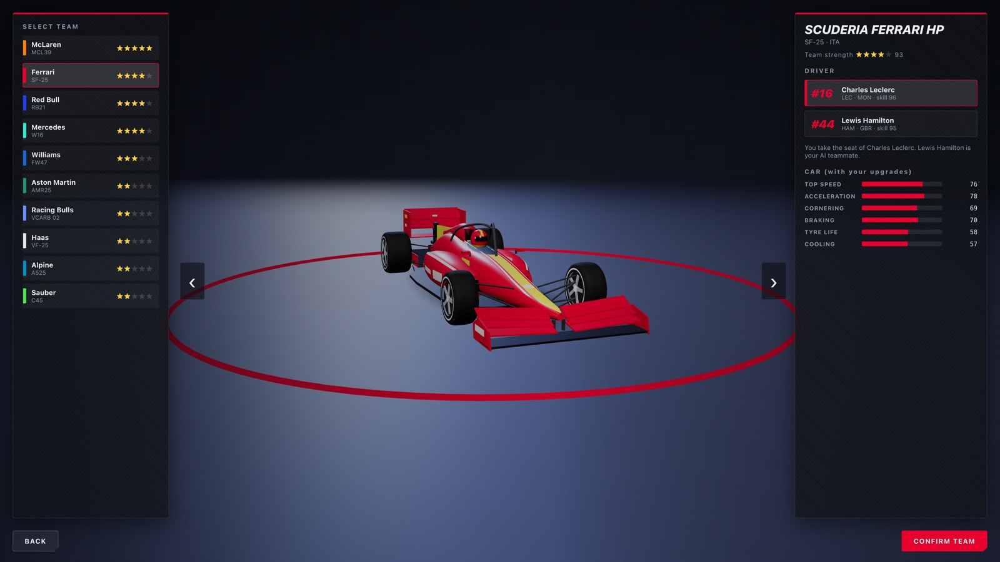
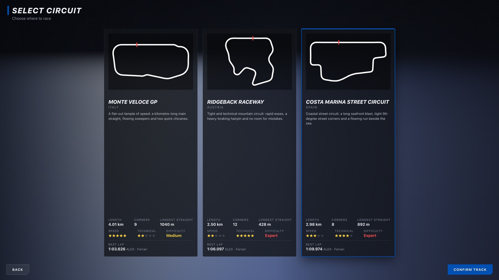
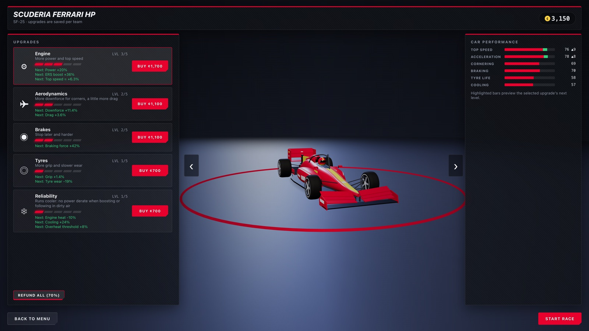
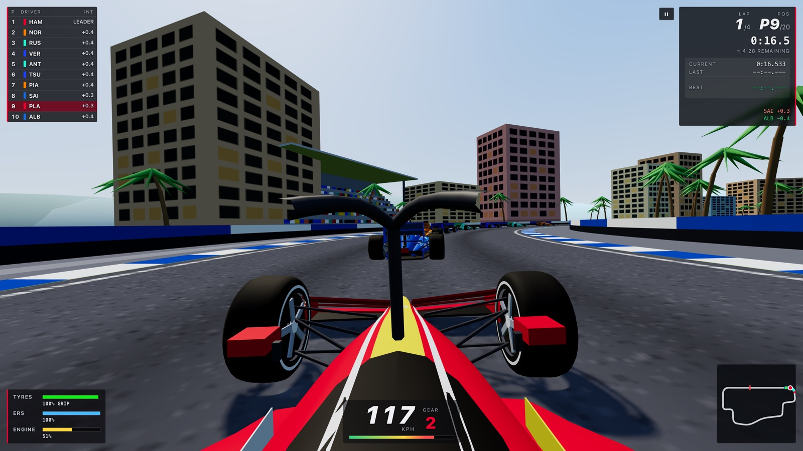
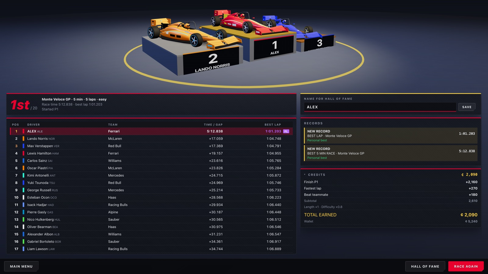

<div align="center">

# 🏁 CarRace

**A Formula-style racing game that runs in your browser. Built on Three.js. No build step, no assets, no installs.**

[](LICENSE)
[](https://threejs.org)
[](#-quick-start)
[](#-tests)



**3 circuits · 10 teams · 20-car grid · 5 to 10 minute races · upgrades · Hall of Fame**

</div>

---

## 🎮 What is it?

Pick a team from the **2025 Formula grid**, choose a circuit and a race length (5, 7 or 10 minutes), spend your credits in the garage, and race 19 AI drivers for the podium. Everything you see and hear is generated in code: the cars, the tracks, the textures, even the engine sound.

<table>
<tr>
<td width="50%"><br><sub><b>Title</b>: your driver name, credits and the Ferrari SF-25 on the turntable</sub></td>
<td width="50%"><br><sub><b>Team select</b>: 10 teams, 20 drivers, each with its own stats and livery</sub></td>
</tr>
<tr>
<td width="50%"><br><sub><b>Three circuits</b>, each with a different character and your best laps</sub></td>
<td width="50%"><br><sub><b>Garage</b>: spend credits on engine, aero, brakes, tyres and cooling</sub></td>
</tr>
<tr>
<td width="50%"><br><sub><b>Cockpit camera</b> (press <kbd>C</kbd>): halo, front wheels and the pack ahead</sub></td>
<td width="50%"><br><sub><b>Podium</b>: results, credits earned and new Hall of Fame records</sub></td>
</tr>
</table>

## ✨ Features

- 🏎️ **2025 grid.** 10 teams and 20 drivers, each with its own car stats and livery. Cars are modelled procedurally: nose, front and rear wings, halo, sidepods, slick tyres.
- 🗺️ **3 distinct circuits.** A flat-out speed track, a tight technical one and a coastal street circuit (see below).
- ⏱️ **Short races.** Pick 5, 7 or 10 minutes. The lap count is calculated per track so the race lasts about as long as you chose. Easy, Normal and Hard AI.
- 🔧 **Car upgrades.** Engine, aero, brakes, tyres and cooling at levels 0 to 5, paid with credits you earn from results. Refundable at 70%.
- 🏆 **Hall of Fame.** Per-track best laps and best race times, win and podium counts, and race history, saved in your browser.
- 🛞 **Race mechanics.** Tyre wear, engine heat, ERS boost, a start-lights sequence, off-track penalties, car-to-car contact and automatic recovery if you get stuck.
- 🔊 **Synthesised audio.** Engine note that follows RPM, tyre squeal, ambience. No audio files.
- 📱 **Responsive UI.** Broadcast-style HUD with a leaderboard tower, minimap, tyre, ERS and engine gauges. It adapts to laptops and phones.

## 🗺️ The circuits

| Circuit | Character | Length | Corners | Longest straight | Difficulty |
| --- | --- | --- | --- | --- | --- |
| **Monte Veloce GP** | A flat-out temple of speed: kilometre-long main straight, sweepers, two chicanes | 4.01 km | 9 | 1040 m | Medium |
| **Ridgeback Raceway** | Tight mountain circuit: rapid esses, a heavy-braking hairpin | 2.50 km | 12 | 428 m | Expert |
| **Costa Marina Street Circuit** | Coastal street track: seafront blast, 90-degree corners, a run beside the sea | 2.98 km | 8 | 892 m | Expert |

## 🏁 The grid (2025 season)

| Team | Car | Team | Car |
| --- | --- | --- | --- |
| McLaren | MCL39 | Williams | FW47 |
| Ferrari | SF-25 | Racing Bulls | VCARB 02 |
| Red Bull | RB21 | Haas | VF-25 |
| Mercedes | W16 | Sauber | C45 |
| Aston Martin | AMR25 | Alpine | A525 |

## 🚀 Quick start

```bash
git clone https://github.com/alexander-uspenskiy/CarRace.git
cd CarRace
npm run serve        # then open http://localhost:8000
```

No bundler and no dependencies are needed to play: Three.js is vendored in `vendor/`. You only need `npm install` to run the tests. The game must be served over http (opening `index.html` from disk won't work) and needs a modern desktop browser with WebGL.

Add `?debug=1` for verbose logging. `window.__game` exposes a debug and automation hook.

## ⌨️ Controls

| Key | Action |
| --- | --- |
| <kbd>↑</kbd> / <kbd>W</kbd> | Throttle |
| <kbd>↓</kbd> / <kbd>S</kbd> | Brake (hold at standstill to reverse) |
| <kbd>←</kbd> <kbd>→</kbd> / <kbd>A</kbd> <kbd>D</kbd> | Steer |
| <kbd>Space</kbd> | Handbrake |
| <kbd>Shift</kbd> | ERS boost |
| <kbd>R</kbd> | Reset car to the track |
| <kbd>C</kbd> | Change camera (chase / cockpit) |
| <kbd>Esc</kbd> / <kbd>P</kbd> | Pause |
| <kbd>Enter</kbd> | Skip intro / confirm |
| <kbd>H</kbd> | Help overlay |

A standard-mapping gamepad also works: left stick steers, RT is throttle, LT is brake, A is boost, X is handbrake.

## 🧠 How it was built

CarRace was built by a team of AI agents coordinated with [Claude Code](https://claude.com/claude-code): an **architect** wrote the design spec, a **critic** reviewed it and fixed 38 issues before any code existed, four **coders** built the data, physics, rendering and UI packages in parallel, and **testers** drove the game in a real browser, ran balance simulations and checked visuals. A second round of fix agents and a final code review closed out what they found. The spec and the agents' notes are in [`docs/`](docs/).

The simulation is deterministic and runs on a fixed timestep, independent of the frame rate. It has no DOM or Three.js dependency, so the whole game logic is unit-tested in plain Node.

## 🧪 Tests

```bash
npm install
npm test             # ~330 tests, no browser needed
```

## 📁 Project structure

```
index.html, styles.css   page shell and styles
src/main.js              entry point (boot, fatal-error screen)
src/debug.js             window.__game hook and error log
src/game/                game orchestrator (main loop, flow wiring), race finalisation
src/sim/                 deterministic fixed-step simulation: physics, AI, rules (no DOM)
src/render/              Three.js: RenderHost, race scene, car models, track, cameras, minimap
src/audio/               WebAudio synthesis
src/ui/                  HUD, screens, input, state machine
src/data/                teams, tracks, upgrades, economy, save store, Hall of Fame
src/core/                math, track model, storage, event bus
tests/                   node unit tests
docs/                    architecture, notes, README images
marketing/               4K screenshots and the script that captures them
vendor/                  vendored three.module.js
```

## 📄 License

MIT, see [LICENSE](LICENSE). Three.js (vendored in `vendor/`) is also MIT-licensed.

> **Unofficial fan project.** Team, car and driver names are used descriptively only. This game has no affiliation with, or endorsement by, Formula 1, the FIA or any team.
